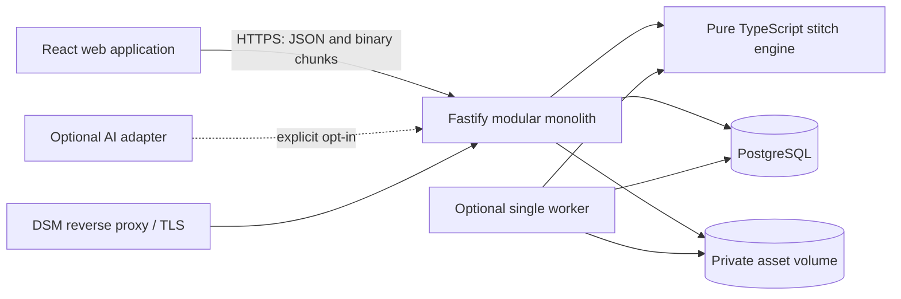
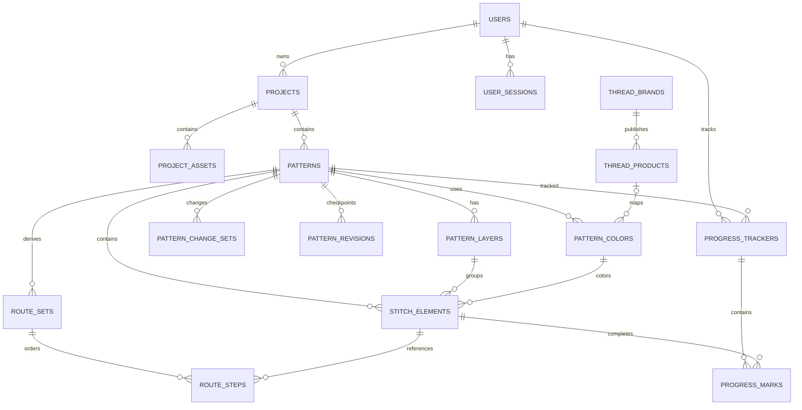

# Cocolla application architecture proposal

**Status:** Approved as the initial technical direction on 2026-10-18
**Prepared:** 2026-10-18
**Scope:** COC.1 architecture and foundation planning

## Executive recommendation

Build Cocolla as a TypeScript modular monolith with three independently bounded parts:

1. A React single-page application for workflows, tools, and a layered Canvas 2D editor.
2. A Fastify HTTP API that owns authentication, authorization, validation, persistence, imports, exports, and job coordination.
3. A UI- and database-independent TypeScript stitch engine that owns document rules, stitch-technique behavior, geometry, routing inputs, serialization, and deterministic commands.

Use PostgreSQL as the transactional source of truth. Keep uploaded source images and generated export files in a filesystem-backed asset store behind an interface. Deploy a small same-origin web/API container plus PostgreSQL on Synology Container Manager; add a single-concurrency worker process only when imports, routing, or exports require it. Do not require Redis, Kubernetes, cloud object storage, or any AI service.

This is a good fit for a private, self-hosted design application because it minimizes moving parts on a 4 GB NAS while retaining clean seams for scale-sensitive rendering, background jobs, new stitch techniques, and optional AI providers.

## Documentation audit

### Verified facts at approval and current implementation note

- At the time of the audit, the repository contained governance and ICM documentation only.
- The architecture is now approved. Milestone 1 implements only the document contract and stitch engine; UI, backend, database, and deployment remain absent.
- `repoinspire.md` contains one canvas-UX inspiration candidate and explicitly records no adoption.
- The target Synology DS923+ has an AMD Ryzen R1600, 4 GB base RAM, and is listed by Synology as compatible with Container Manager.

### Inconsistencies and gaps

| Area | Audit finding | Resolution / remaining action |
| --- | --- | --- |
| Product wording | Overview files could read as if planned features already existed. | `README.md` and ICM context now distinguish intended features from verified implementation; `AGENTS.md` remains a concise product identity statement. |
| ICM context | `context.md` had unresolved “Major parts” and “Sources of truth” sections. | Resolved after approval with implemented/planned labels and authoritative links. |
| Invariants | `invariants.md` contained only a placeholder. | Resolved after approval with the engine, privacy, derived-route, migration, AI, and compatibility invariants. |
| Current state | `current-state.md` had a TODO. | Resolved with verified Milestone 1 evidence and explicit non-implementation statements. |
| Roadmap | `roadmap.md` contained placeholders. | Resolved with completed milestones and later work marked as requiring authorization. |
| Product boundaries | Sharing, simultaneous collaboration, offline editing, mobile editing, supported import/export formats, pattern-size targets, account recovery, and retention are unspecified. | Treat them as non-goals until separately decided; set measurable size/browser targets before the canvas implementation is locked. |
| Operations | Backup/restore objectives, remote-access model, TLS ownership, email availability, and monitoring/alerting are unspecified. | Decide before production deployment, not during initial implementation. |
| Thread data | No thread-catalog source or license decision exists. | Begin with user-created thread products; import third-party catalogs only after provenance and license review. |

ICM was updated only after approval and verified Milestone 1 implementation results.

## System context and boundaries



The production API serves the compiled SPA so the browser uses one origin. This simplifies cookies, CSRF protection, proxying, and deployment. The worker is the same codebase and image with a different entry point, not a separate service architecture.

## Stack evaluation

### React + TypeScript: recommend

React is appropriate for the application shell, inspectors, dialogs, palettes, and state-driven tools. TypeScript lets the browser, API contracts, and engine share vocabulary without sharing infrastructure. React must not own one component per stitch: the dense design surface is an imperative renderer synchronized through a small adapter, while React owns the surrounding UI.

Prefer a client-rendered SPA. Cocolla has little SEO value, and server-side rendering would add runtime and hydration complexity without improving the editor. The exact build tool and state library remain implementation decisions.

### Fastify on a supported Node.js LTS: recommend

Fastify is a small, schema-oriented HTTP boundary with good TypeScript support and low operational overhead. Organize it by product modules rather than route/controller/database technical layers. Validate request and response data at the boundary and publish an OpenAPI description from the same schemas where practical.

Use a supported Node.js LTS line and pin exact versions in source and container images. Fastify's major version must be selected against that Node line at implementation time.

### PostgreSQL: recommend

The domain is relational: ownership, palettes, thread mappings, stitch elements, routes, revisions, and per-user progress require constraints and transactions. PostgreSQL provides a durable local deployment, JSONB for versioned technique payloads, row-level security for defense in depth, and efficient indexing for ownership and spatial chunk access.

Use lowercase `snake_case`, `bigint generated ... as identity` internal primary keys, `timestamptz`, explicit check/unique constraints, and indexes on foreign keys. Use opaque public IDs at API boundaries so sequential internal IDs are never exposed. Keep the application connection pool small; PgBouncer is unnecessary for one API and one worker unless measurements show otherwise.

### Standalone TypeScript stitch engine: strongly recommend

This is the most important long-term boundary. The engine must not import React, Canvas APIs, Fastify, PostgreSQL clients, filesystem APIs, or AI SDKs. Both client and server may call it. The server always revalidates commands before persistence; browser validation is for responsiveness, not trust.

### Windows development and containerized Synology: recommend with constraints

During development, run Node processes natively on Windows for fast feedback and run PostgreSQL in a pinned local container. A complete Compose profile should also be tested in CI or locally before releases. Production uses Linux containers on Synology Container Manager. Never use floating `latest` image tags.

## Module boundaries

| Module | Owns | Must not own |
| --- | --- | --- |
| `engine` | Document model, integer coordinates, technique registry, commands, validation, geometry primitives, route calculation, estimates, deterministic serialization | UI state, database calls, HTTP, files, user identity, AI calls |
| `contracts` | Versioned API DTOs, command envelopes, error shapes, identifiers | Domain behavior or persistence |
| `web` | React workflows, editor tools, viewport/camera, Canvas renderer, local undo stack, accessibility UI, API client | Authorization decisions or canonical validation |
| `api` | Authentication, authorization, use cases, transactions, API validation, asset access, job scheduling | Canvas rendering or provider-specific AI logic |
| `db` | Migrations, repositories, row-level policies, query implementations | HTTP handlers or domain geometry |
| `worker` | Bounded import, route, thumbnail, and export jobs using API application services | A second set of domain rules |
| `ai` | Optional provider-neutral port and adapters | Direct database writes or required core behavior |

Use dependency direction `apps -> application services -> domain/engine`; infrastructure implements ports defined inward. Avoid a premature microservice split. Module boundaries and tests provide separation without network, deployment, or consistency costs.

## Proposed directory structure

```text
apps/
  web/
    src/
      app/
      features/
      editor/
        renderer/
        tools/
        viewport/
  api/
    src/
      modules/
        auth/
        projects/
        patterns/
        threads/
        progress/
        imports/
        exports/
      platform/
  worker/
    src/
packages/
  engine/
    src/
      document/
      techniques/
      commands/
      geometry/
      routing/
      serialization/
  contracts/
    src/
  db/
    migrations/
    src/
  test-support/
docs/
  architecture/
  decisions/
  icm/
ops/
  containers/
  compose/
```

This is a logical target, not scaffolding authorization. The package manager, workspace tool, bundler, test runner, schema library, and SQL access library still require selection.

## Domain and persistence model

### Modeling rules

- A project is privately owned by one user. Sharing and organization ownership are not in the initial model.
- A pattern is an editable design inside a project; a project may hold multiple patterns and source assets.
- The canonical editable document is stitch elements plus layers, logical colors, and pattern settings—not pixels.
- Front appearance is derived from stitch elements and fabric settings. Estimated back appearance is derived from an explicit route. Neither is stored as independently editable artwork.
- Thread products are optional physical mappings. A logical pattern color remains valid without one.
- Each stitch element has a stable opaque identifier so progress and route steps can survive ordinary edits.
- Every mutating command carries a base document revision. The API atomically rejects stale writes and returns conflict data.
- Immutable checkpoints support history and reproducible exports; routes and previews record the document revision that produced them and become stale after relevant edits.

### Core relationships



### Initial tables

| Table | Important fields and purpose |
| --- | --- |
| `users` | Internal identity, opaque public ID, display name, normalized unique login name/email, status, timestamps. Authentication secrets are separate. |
| `user_credentials` | User FK, password hash and algorithm metadata, rotation timestamp. Never expose or log this row. |
| `user_sessions` | Hashed session token, user FK, expiry, revocation, last-seen metadata. Use secure HttpOnly same-site cookies. |
| `projects` | Owner user FK, opaque public ID, name, description, settings, timestamps, soft archive state. Ownership is mandatory. |
| `project_assets` | Project FK, kind, private storage key, content type, byte size, checksum, image dimensions, import metadata. No public filesystem paths. |
| `patterns` | Project FK, public ID, name, integer bounds, units per fabric cell, fabric settings, current revision, schema version, timestamps. |
| `pattern_layers` | Pattern FK, stable key, name, order, visibility/lock defaults. |
| `pattern_colors` | Pattern FK, stable key, display name, RGB/sRGB value, symbol, optional thread product FK. Unique symbol/key per pattern. |
| `thread_brands` | User-defined or licensed catalog provenance, name, source/license metadata. |
| `thread_products` | Brand FK, line, manufacturer code, name, display color and optional color-space measurements; unique `(brand, line, code)`. |
| `stitch_elements` | Pattern/layer/color FKs, stable public ID, `technique_key`, technique schema version, integer anchor/bounds, validated JSONB geometry/properties, element revision, timestamps. The common columns support chunk queries; the technique payload supports extension. |
| `pattern_change_sets` | Pattern FK, actor user, base/result revision, ordered validated command batch, request id, timestamp. Provides audit and bounded replay; periodic checkpoints prevent unbounded replay. |
| `pattern_revisions` | Immutable checkpoint metadata: pattern revision, engine/schema versions, checksum, creator, reason, timestamp. Chunked payload rows can be introduced once checkpoint size requires them. |
| `route_sets` | Pattern FK, source revision, algorithm key/version, scope/color, status, estimates, generated timestamp. Any source edit marks affected sets stale. |
| `route_steps` | Route FK, order, stitch element FK, chosen entry/exit points, action such as stitch/jump/trim. Unique `(route_set_id, step_index)`. |
| `progress_trackers` | User and pattern FKs, baseline revision, timestamps; unique per user/pattern for the initial product. |
| `progress_marks` | Tracker and stitch-element FKs, status, element revision when marked, completion timestamp; unique per tracker/element. |
| `jobs` | Bounded database-backed work queue for import, route, thumbnail, and export jobs, with type, payload, state, attempts, lease, and owner/project scope. |
| `export_artifacts` | Project/pattern and source revision, format, private storage key, checksum, expiry/retention state. |

### Index and security baseline

- Index every foreign key used for joins, ownership checks, or cascades.
- Use composite indexes that follow actual access paths, initially `(owner_user_id, updated_at desc)` for project lists; `(pattern_id, anchor_y, anchor_x)` for viewport reads; `(pattern_id, technique_key)` where technique filtering is measured; and `(tracker_id, status)` for progress.
- Avoid speculative indexes on low-cardinality columns. Confirm later indexes with query plans and production-like data.
- Use a small application pool (provisional range 5–10 connections per process) and a conservative database connection ceiling on the 4 GB target.
- The application database role is non-owner, non-superuser, and cannot bypass row security. Migrations use a separate role.
- Enable and force PostgreSQL row-level security on user-owned tables. For each authenticated transaction, set a local user context and enforce ownership through the project relationship. Application repository methods also require the user ID; RLS is defense in depth.
- Cross-user integration tests must prove that list, direct-ID fetch, mutation, asset download, route, export, and progress endpoints cannot cross tenant boundaries.

### Large-pattern storage decision

Start with normalized `stitch_elements` because it provides integrity, stable IDs, incremental updates, and simple progress relationships. Hide persistence behind a pattern repository and load/save command batches, not raw table access from handlers.

Before declaring the model final, benchmark representative sparse and dense documents at 10k, 100k, and 500k elements. If row overhead, payload size, or save latency misses approved targets, retain relational metadata but move element bodies to fixed spatial chunks with optimistic chunk versions. Immutable checkpoint payloads should be chunked and compressed when their measured size justifies it. Partitioning is not justified initially.

## Technique-extensible stitch engine

Use integer document coordinates with a declared scale, provisionally 1024 units per fabric cell. Grid techniques enforce their own alignment (full, half, or quarter cell); future freeform techniques can use arbitrary integer coordinates. Pixels never enter the saved domain model.

A technique is registered by stable key and version and implements a contract equivalent to:

```ts
interface StitchTechnique<TPayload> {
  readonly key: string;
  readonly version: number;
  decode(value: unknown): TPayload;
  validate(element: StitchElement<TPayload>, context: PatternContext): Issue[];
  bounds(element: StitchElement<TPayload>): Bounds;
  frontGeometry(element: StitchElement<TPayload>): readonly Primitive[];
  routeOptions(element: StitchElement<TPayload>): readonly RouteOption[];
  estimate(element: StitchElement<TPayload>, route: RouteChoice): StitchEstimate;
}
```

`Primitive` is an engine-owned geometric description such as a line, curve, polygon, or knot—not a Canvas or SVG object. Renderers adapt primitives to a target. A cross-stitch technique is the first implementation; adding another technique means adding a module and migrations only if that technique needs indexed fields, not rewriting the document or canvas.

Technique payloads are versioned, validated on decode, and migrated explicitly. Unknown future technique keys must be preserved during round trips and shown as unsupported rather than silently dropped. Commands such as add, move, recolor, delete, and batch transform are deterministic values that can be used by the browser, API, imports, and future agents.

The back view uses selected entry/exit points and ordered route steps. It is labeled an estimate because real stitchers can change routes, tension, starts, stops, and carried thread.

## Canvas rendering evaluation

| Approach | Strengths | Weaknesses | Decision |
| --- | --- | --- | --- |
| SVG / one DOM node per mark | Crisp vectors, simple inspection, accessible elements | DOM and reconciliation costs grow poorly for dense patterns | Suitable for export/preview, not the primary editor |
| Canvas 2D | Broad support, direct control, good text/line rendering, straightforward layered caching | Manual hit testing and accessibility; CPU-bound if everything redraws | Recommended initial editor |
| WebGL | Instancing and GPU throughput for very large dense designs | More complex shaders, text, picking, context recovery, and testing | Keep behind a renderer interface; adopt only after benchmarks |
| WebGPU | Modern compute/render capabilities | Higher implementation and compatibility risk | Not an initial dependency |
| Object-scene canvas libraries | Faster prototyping for generic diagrams | Object-per-stitch memory overhead and framework-specific document coupling | Evaluate only if a focused spike beats the custom renderer |

The initial renderer should use stacked canvases for cached fabric/grid, stitch tiles, and transient overlays. It should:

- Keep the camera transform (`document -> screen`) independent from document data.
- Cull to the visible viewport and render fixed spatial tiles.
- Cache repeated stitch glyphs and static tiles; invalidate only affected tiles.
- Normalize pointer, pen, keyboard, and wheel input into editor commands.
- Use a spatial index or tile-local lookup for hit testing instead of color-picking initially.
- Scale for `devicePixelRatio` while keeping CSS size responsive.
- Move tile rasterization or route calculations to a Web Worker/OffscreenCanvas only after profiling shows main-thread pressure.
- Keep accessible DOM controls, keyboard operations, coordinates, selection summaries, and non-color symbols outside the bitmap.

Provisional performance acceptance targets should be approved before implementation: interactive pan/zoom for 100k visible-or-loaded elements on a representative client, under 50 ms command feedback, bounded memory during a 500k-element load test, and no full-document redraw for a single-element edit. The NAS affects API/storage performance; rendering performance primarily depends on the user's browser device.

## API, concurrency, and background work

- Use versioned REST resources and JSON command batches. Reserve binary, compressed chunk responses for measured large-document needs.
- Every write supplies `base_revision`; one transaction validates ownership and commands, applies changes, writes a change set, increments the pattern revision, and invalidates derived routes/exports.
- Keep undo/redo local as inverse commands. Persist checkpoints/history separately; do not make browser undo state canonical.
- Simultaneous co-editing is out of initial scope. Optimistic conflicts are explicit and never last-write-wins. Real-time collaboration would require a separate product and consistency decision.
- Claim jobs with short transactions and `FOR UPDATE SKIP LOCKED`; make handlers idempotent and bounded by attempts/timeouts. Start with one worker concurrency on the NAS.
- Decode untrusted images and pattern archives in the worker with strict file-size, pixel-count, decompression, path, and time limits.

## Optional AI extension boundary

The core has no AI dependency. Define an optional application port such as:

```ts
interface DesignAssistant {
  capabilities(): readonly AiCapability[];
  propose(request: AiRequest, snapshot: RedactedPatternSnapshot): Promise<AiProposal>;
}
```

An AI result is an untrusted proposal containing ordinary engine commands, explanations, and provenance. It never writes directly to the database. The API validates the proposal with the same engine and authorization path as human edits, shows a diff/preview, and requires confirmation unless a future policy explicitly allows a narrower action.

Default configuration is `disabled`. Provider adapters live outside the engine, load only when configured, and declare whether data leaves the host. Send the minimum scoped snapshot, exclude credentials and unrelated projects, record user consent and provider/model metadata, enforce time/cost limits, and support cancellation. Local models are not assumed viable on the 4 GB NAS.

## Deployment and operations

### Production shape

- DSM reverse proxy terminates TLS and forwards one origin to the app container.
- The app container serves the static SPA and Fastify API as a non-root user.
- PostgreSQL uses a dedicated persistent volume and is not exposed outside the container network.
- Private uploads/exports use a separate persistent volume accessed only through authorized API endpoints.
- The optional worker uses the same immutable application image and remains at concurrency one unless measured otherwise.
- Compose uses health checks, explicit restart policies, secrets outside source control, read-only application filesystem where practical, pinned image digests/versions, and bounded logs.

On 4 GB RAM, start with conservative memory and connection limits, no Redis, no local AI model, and no unbounded import/export parallelism. Leave meaningful headroom for DSM and filesystem cache. Establish resource budgets through a target-device soak test before production approval.

### Backup and recovery

Back up PostgreSQL and the asset volume as one recoverable set. A database dump without its referenced files is incomplete. Keep backups outside the NAS failure domain when possible, encrypt sensitive backups, define retention, and run documented restore drills. Decide RPO/RTO before deployment. Schema migrations must be forward-tested against a restored production-like copy and should be reversible or have a documented recovery path.

## Alternatives considered

| Alternative | Why it is not the initial recommendation | Reconsider when |
| --- | --- | --- |
| Full-stack SSR React framework | SEO and server-rendered first paint add little to an authenticated design tool, while coupling UI routing/build concerns to the server | A substantial public, indexable experience becomes a requirement |
| Microservices | Adds networking, deployments, observability, memory use, and distributed consistency to a 4 GB single-host target | Independent scaling or team ownership is demonstrated, not anticipated |
| SQLite | Simple operations, but weaker fit for concurrent multi-user writes, row-level tenant defense, and worker coordination | Cocolla becomes deliberately single-user/single-process |
| Event sourcing as the only source of truth | Excellent history but raises replay, migration, and query complexity before collaboration requirements exist | Full audit/replay or collaborative merge semantics become central |
| S3-compatible object storage | Adds another service and memory/operational burden on the NAS | Multiple application hosts or remote object lifecycle requirements appear |
| Immediate WebGL renderer | Higher peak throughput, but more implementation and accessibility complexity before a measured need | Canvas 2D fails the approved benchmark gate |

## Architectural risks and mitigations

| Risk | Impact | Mitigation / alternative |
| --- | --- | --- |
| Dense patterns overwhelm browser CPU/memory | Unusable editor | Culling, tiles, glyph caches, workers, representative benchmarks; swap Canvas 2D adapter for WebGL if thresholds fail |
| Row-per-element storage becomes bulky | Slow loads/saves, large backups | Repository boundary, batched writes, checkpoint compression; move bodies to versioned spatial chunks if benchmark gate fails |
| Cross-user data leak | Critical privacy failure | Mandatory owner FK, scoped repositories, forced RLS, non-owner DB role, cross-tenant tests, authorized asset streaming |
| Stale routes/progress after edits | Misleading back view or completion | Stable element IDs, element revisions, source revision on derived data, explicit stale state and recomputation |
| Concurrent edits overwrite work | Data loss | Optimistic revision checks and transactional command batches; defer co-editing |
| Untrusted imports exhaust resources | Availability/security incident | Worker isolation, strict size/pixel/archive/time limits, format allowlist, no executable content |
| NAS memory pressure | Database/app crashes | Small pools, single worker, resource limits, no extra infrastructure, target-device soak tests; RAM upgrade remains an operational alternative |
| NAS or disk loss | Irrecoverable projects | Consistent off-device backups and routine restore tests |
| Thread catalog/IP restrictions | Cannot legally distribute catalog data | User-entered products first; provenance and license review before bundled data |
| AI data egress or unsafe edits | Privacy/data-integrity failure | Disabled by default, minimal scoped data, explicit provider disclosure/consent, proposal-only commands and validation |
| Technique payload evolution | Old designs become unreadable | Version each payload and document schema; migration fixtures and unknown-type preservation |

## Approved direction and remaining selections

The project owner approved items 1–10 below on 2026-10-18, subject to preserving non-grid techniques, separating logical geometry from routes, keeping the document UI/database independent, retaining governance, keeping AI optional, and supporting Windows plus isolated Synology containers.

1. Adopt the React + TypeScript SPA, Fastify modular monolith, supported Node.js LTS, PostgreSQL, and standalone engine direction.
2. Adopt same-origin production serving and Compose deployment through Synology Container Manager.
3. Adopt private single-owner projects initially; defer sharing and simultaneous co-editing.
4. Adopt normalized current stitch elements plus benchmark-gated spatial chunking, with immutable checkpoints.
5. Adopt integer document coordinates and a versioned technique registry.
6. Adopt custom layered Canvas 2D first, with a renderer abstraction and performance gate for WebGL.
7. Adopt optimistic command batches, periodic checkpoints, and database-backed background jobs.
8. Adopt application authorization plus forced PostgreSQL RLS as defense in depth.
9. Adopt filesystem-backed private assets and require coordinated database/file backups.
10. Adopt AI as disabled-by-default proposal adapters outside the core.
11. Provisional scale/performance targets remain subject to representative client and target-device testing. Milestone 1 established 10k/100k engine baselines but did not validate browser rendering or Synology operation.
12. Milestone 1 selected npm, TypeScript 5.9.3, Node 24 LTS types/runtime, and the built-in Node test runner. Web, API, SQL, authentication, and deployment tool versions remain unselected until their authorized milestones.

## Primary evaluation sources

- [React TypeScript guidance](https://react.dev/learn/typescript)
- [React integration with external systems](https://react.dev/learn/escape-hatches)
- [Fastify documentation](https://fastify.dev/docs/latest/)
- [Fastify TypeScript reference](https://fastify.dev/docs/latest/Reference/TypeScript/)
- [Node.js release policy and supported lines](https://nodejs.org/en/about/previous-releases)
- [PostgreSQL current documentation](https://www.postgresql.org/docs/current/)
- [PostgreSQL license](https://www.postgresql.org/about/licence/)
- [Canvas optimization guidance](https://developer.mozilla.org/en-US/docs/Web/API/Canvas_API/Tutorial/Optimizing_canvas)
- [OffscreenCanvas reference](https://developer.mozilla.org/en-US/docs/Web/API/OffscreenCanvas)
- [Docker Compose production guidance](https://docs.docker.com/compose/how-tos/production/)
- [Synology Container Manager compatibility](https://www.synology.com/en-global/dsm/packages/ContainerManager)
- [Synology DS923+ hardware manual](https://kb.synology.com/en-ph/HIGs/DS923p_HIG/1)
